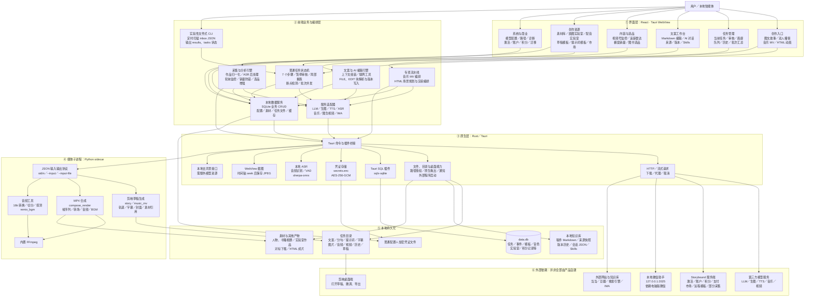
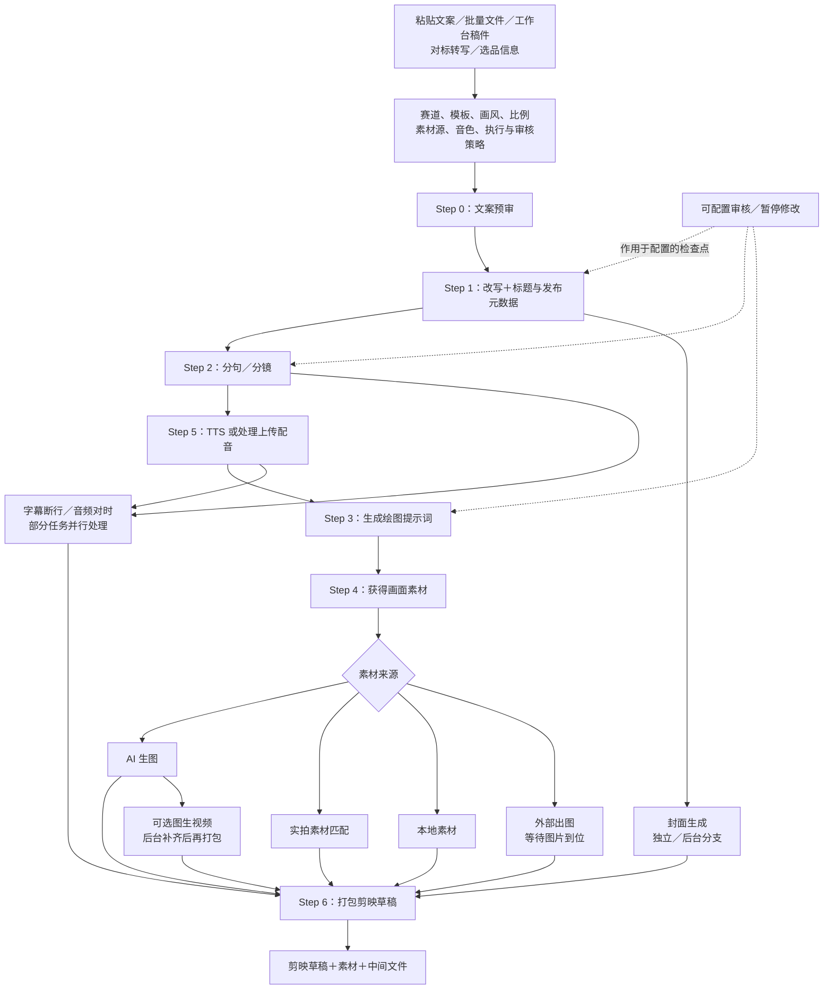
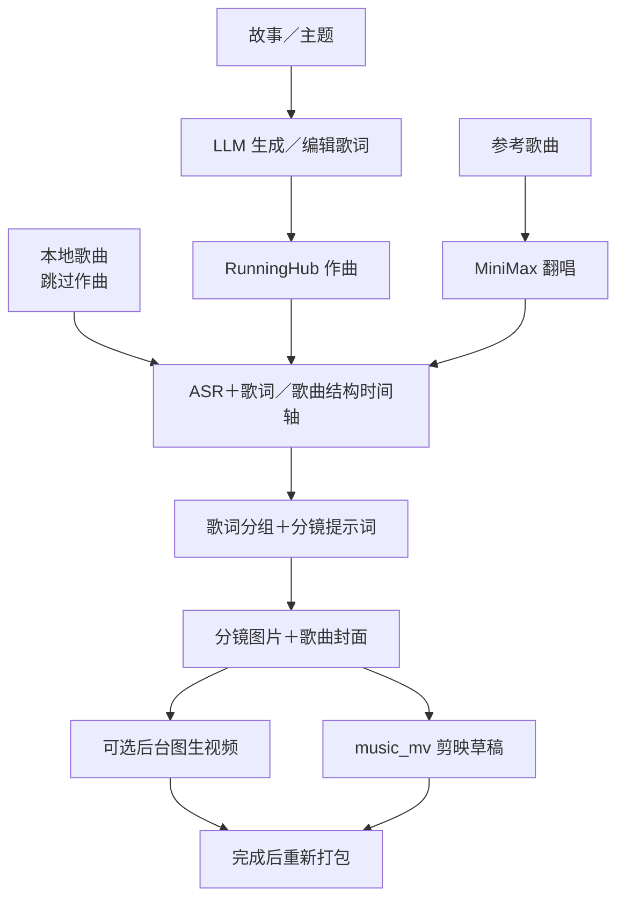
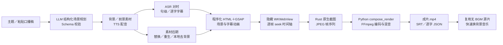
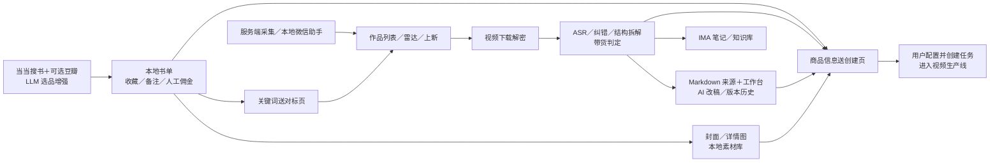

# Storybound 1.27.0 架构图

整理日期：2026-11-12。

本文根据已完成的 REA 静态分析、安装包资源与原生调用检查、官网及公开教程整理。**描述对象是参考产品 Storybound，不是本项目“映序”的实现架构，也不是后续开发承诺。** 自研状态仍以 [功能总清单](../FEATURES.md) 为准。

- [原产品功能清单](功能清单.md)
- [证据、来源与限制](证据与限制.md)
- [返回项目说明](../../README.md)

## 一、分析对象与结论

| 项目 | 本轮结论 |
|---|---|
| 安装包 | 工作区根目录的 `installer.dmg`，具体身份见证据文档 |
| 产品版本 | Storybound 1.27.0 |
| 包内平台 | Apple Silicon ARM64，最低 macOS 13.4；不构成 Intel x64 兼容证明 |
| 桌面外壳 | Tauri／Rust；macOS 使用 WKWebView |
| 界面 | React 打包资源，包含 TypeScript 工程痕迹 |
| 业务编排 | 主要位于前端 JavaScript：任务状态机、数据库访问、模型适配及专项流程 |
| 原生能力 | 网络与下载、文件／桌面桥接、SQLite 插件、凭证、ASR、截图等 |
| 媒体子进程 | PyInstaller 打包 Python 3.11，负责剪映工程与媒体处理 |
| 剪映工程 | `generate_draft_lib` 与 `pyJianYingDraft` |
| MP4 编码 | sidecar 携带的 FFmpeg；已确认的直接成片主链是 HTML 动画 |
| 本地 ASR | sherpa-onnx／ONNX Runtime，SenseVoice 路线，需另备模型资源 |
| 云端 | 模型服务、产品账户／计费／市场、部分数据采集等；服务端内部架构未知 |

本轮没有启动原客户端、登录、支付或请求生成模型。下图表示**静态实现与调用关系**，不表示各项能力已经运行验收。官网声明、禁用入口及未知项另行标注。

## 二、分层架构



### 关键职责边界

1. **Python 不是任务管理后端。** 前端经 Tauri SQL 插件管理业务数据库；sidecar 消费 JSON 参数及本地素材，输出工程或媒体。
2. **Agent 名称不等于独立进程。** Reviewer／Writer／Storyboard／Producer 是业务逻辑角色，不能据此认定四个常驻服务。
3. **本地不等于离线。** 编辑、文件与部分模型推理本地执行；生成服务、账户及部分采集需要网络。
4. **产品服务端内部未知。** 图中按可见接口划分职责，不推断其数据库、语言、微服务或部署方式。
5. **原产品与自研不同。** 自研采用 Electron／React／严格 TypeScript／FFmpeg／Sharp；本文不改变其架构、状态或路线。

## 三、普通图文／故事／播客生产线

### 3.1 实际步骤顺序

界面使用 Step 0—6，但正常编排数组为 **`[0,1,2,5,3,4,6]`**：配音提前执行。字幕、对时、封面及动态图还有并行或后台分支，不能按首页画成完全串行。



图中步骤编号沿用产品。不同素材模式可能跳过提示词与生图阶段；单图播客也不等同于普通多分镜任务。

### 3.2 执行模式

| 模式 | 静态观察到的行为 |
|---|---|
| `auto` | 完整流程 |
| `semi_auto` | 跳过 Step 0 预审与 Step 1 改写 |
| `direct` | 跳过 Step 0／1，分句使用空行机械切分 |

执行模式与“在哪一步暂停审核”分别配置。模型输出中的自评、长度、人物一致性等要求，若只出现在提示词中，不能视为程序硬保证。

## 四、音乐 MV 生产线



- 产物包含歌曲、ASR 结果、对齐 LRC／JSON、封面、图片／视频与草稿。
- ASR 失败可降级为粗时间轴；歌词分组失败可机械合并，质量未验收。
- 当前“本地视频混剪”按钮明确禁用，旧 `video` 设置强制转回 `ai`。遗留的视觉分析函数不能升级认定为开放混剪系统。
- 草稿失败仍可能把歌曲任务标成 `completed`，同时记录 `draftError`，不能只看任务状态验收。
- 未证实该模块可像 HTML 一样通用直出最终 MP4。

## 五、HTML 动画直出 MP4



连接证据：前端调用 `eval_in_window` 执行 `window.__tl.seek`，再用 `capture_webview_by_label` 保存 JPEG，向 sidecar 提交 `mode:"compose_render"`。原生截图函数接通 WKWebView snapshot，sidecar 内存在 H.264／AAC、concat、转场与混音实现证据。

**渲染限制：**窗口创建后固定等待约 800ms，每帧 seek 后固定等待约 45ms；未见逐帧渲染就绪握手。提示词要求原文不增删或素材透明，也不等于逐字相等／透明度已硬校验。

## 六、内容获取与创作闭环



“选品去创作”本身是通过 sessionStorage 带信息跳页，未在该动作中创建任务记录。工作台“应用回原任务”只改写正文，不自动重做下游分镜／配音／图片。

雷达、上新、队列定时与文件式 CLI 均有应用内轮询行为，不构成独立全天候云端守护服务的证据。橱窗自动化另有 Windows 限定，不应因本图省略平台分支而认定 Mac 支持。

## 七、数据与安全边界

| 存储 | 内容与职责 | 边界 |
|---|---|---|
| `data.db` | 任务、事件、删除记录、模板、音色、实验室、积分等 | JS 经 SQL 插件管理，不是 Python 管理任务库 |
| 任务目录 | 正文、JSON、图片、音频、视频、草稿及历史 | 只备份数据库不足以恢复全部内容 |
| 本地知识库 | Markdown 稿件、来源、版本、会话 JSON、Skills | 文件型知识库，不等于向量检索系统 |
| 普通配置 | 服务参数、路径及执行设置 | 常规保存分离敏感字段，迁移失败分支另需注意 |
| `secrets.enc` | 原生加密凭证文件 | 已确认 AES-256-GCM；不能仅凭旧“钥匙串”日志称为系统 Keychain |
| localStorage／sessionStorage | 偏好、缓存、临时跨页信息及部分历史元数据 | 持久化能力随用途不同 |

普通任务典型目录如下；不是每种模式都生成所有文件：

```text
任务目录/
├── 00-reviewed.txt
├── 00-review-notes.txt
├── 00-cover-title.json
├── 01-rewritten-copy.md
├── 01-rewrite-rounds.json
├── 02-sentences.json
├── 03-segments.json
├── 04-image-meta.json
├── 04-material-meta.json
├── 04-video-meta.json
├── 05-captions.json
├── 05-timestamps.json
├── images/
├── videos/
├── segments/
├── image-history/
├── video-history/
└── draft/
```

### sidecar 协议与职责

| 模式／入口 | 静态确认的职责 |
|---|---|
| `story` | 普通剪映草稿 |
| `music_mv` | 音乐 MV 剪映草稿 |
| `compose_render` | JPEG 帧＋配音／BGM 编码 MP4 |
| `remix_bgm` | 使用保留的 `_source.mp4` 快速换 BGM |
| `convert_audio_16k` | 16k 单声道音频转换 |
| `split_audio` | 按区间切分音频 |
| `probe_audio` | 音频探测 |

入口采用 JSON stdin 或 `--input`／`--input-file`，输出 JSON stdout。包内确实携带 `imageio_ffmpeg/binaries/ffmpeg-macos-aarch64-v9.0`，但未执行它验证运行版本。

## 八、架构结论

参考产品更适合建模为：**内容获取与选品 → 文件型文案知识库与 AI 编辑 → 图文／MV／HTML 三条生产线 → 剪映草稿或 MP4 → 素材、模板、任务及商业账户管理。**

本次选择按进程／职责、生产流程、存储与依赖分图，是为了避免把逻辑角色当成服务，把前端编排误放到 Python，或将所有模式误画成直出 MP4。这里没有提出重写或迁移技术栈方案；如需规划自研架构，应另行基于实际需求比较方案，不能直接把本图当实施指令。
